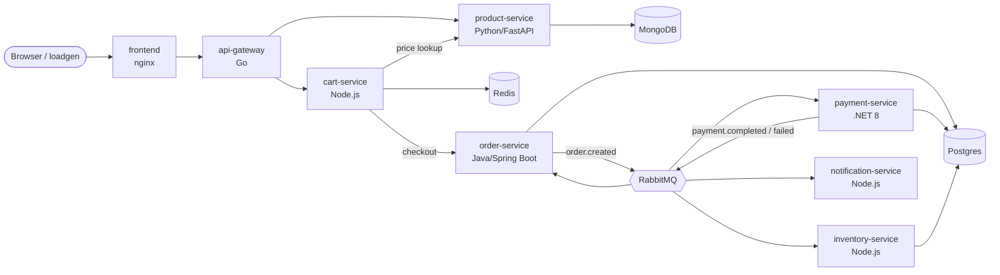
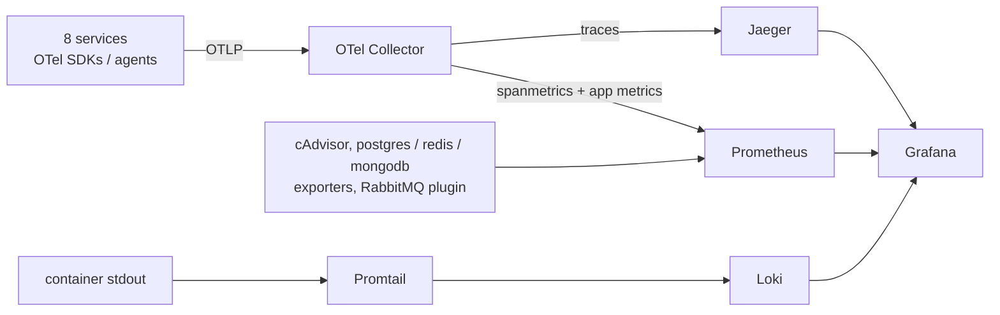

# E-commerce Demo — Docker + OpenTelemetry

A polyglot microservices shop (Go, Python, Java, .NET, Node.js) with a complete,
vendor-neutral observability stack: **traces, metrics and logs**, correlated
with each other, running locally with one command.

```bash
docker compose up -d --build
```

First build takes a few minutes (Maven and NuGet downloads). A built-in load
generator starts placing orders immediately, so dashboards fill up on their own.

| What | URL |
|---|---|
| Shop UI | http://localhost:8080 |
| Grafana (dashboards, logs, traces) | http://localhost:3000 |
| Jaeger (traces, service map, SPM) | http://localhost:16686 |
| Prometheus | http://localhost:9090 |
| RabbitMQ management (guest/guest) | http://localhost:15672 |
| API gateway | http://localhost:8000 |

## Architecture



One checkout produces **a single distributed trace** that crosses 6 services,
4 languages, HTTP and RabbitMQ.

## Observability stack



| Signal | How it's produced | Where to look |
|---|---|---|
| Traces | OTel: Go SDK, Python auto-instrumentation, Java agent, .NET SDK, Node auto-instrumentation | Jaeger, Grafana → Explore → Jaeger |
| RED metrics | Collector `spanmetrics` connector — same metric names for every language | Grafana → *Services — RED overview*, Jaeger → Monitor |
| Business metrics | Custom OTel instruments (`payments_processed`, `cart_checkouts`, `notifications_sent`) | RED dashboard, bottom row |
| Infra metrics | cAdvisor, postgres/redis/mongodb exporters, RabbitMQ Prometheus plugin | Grafana → *Infrastructure* |
| Logs | JSON/structured stdout with `trace_id`, shipped by Promtail | Grafana → Explore → Loki |

**Correlation:** latency panels show exemplars (click a dot → trace), Loki log
lines with a `trace_id` link to Jaeger, and Jaeger spans link back to their logs.

Vendor-neutral by design: to send everything to New Relic, Datadog, Dynatrace,
etc., add that vendor's exporter in `observability/otel-collector.yaml`. No
application code changes.

## Built-in failure modes

So there is something to investigate:

- `product-service`: ~2% HTTP 500s and ~3% slow (0.8–2s) responses (`ERROR_RATE`, `SLOW_RATE`)
- `payment-service`: ~15% card declines (`DECLINE_RATE`). This is a business failure, not a span error
- `loadgen`: ~5% of shoppers request a non-existent product (404s)

Try it: `docker compose stop rabbitmq` and watch latency and errors change, then start it again.

## Common commands

```bash
docker compose ps                         # status
docker compose logs -f order-service      # follow one service
docker compose up -d --build cart-service # rebuild one service
docker compose down                       # stop (keeps data)
docker compose down -v                    # stop and delete all data
```

## Repository layout

```
docker-compose.yml
observability/            collector, prometheus, promtail, grafana provisioning + dashboards
services/
  api-gateway-go/         Go reverse proxy
  product-service-python/ FastAPI + MongoDB
  cart-service-node/      Express + Redis
  order-service-java/     Spring Boot + Postgres + RabbitMQ
  payment-service-dotnet/ ASP.NET Core + Postgres + RabbitMQ
  inventory-service-node/ Express + Postgres + RabbitMQ
  notification-service-node/
  frontend/               static UI served by nginx
  loadgen/                curl-based traffic generator
```

Default credentials are local-demo values. Override them in `.env` (see `.env.example`).

Ecommerce Website


System Architecture


