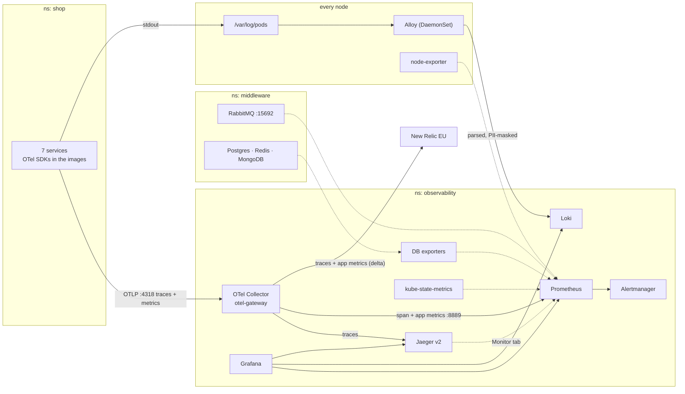
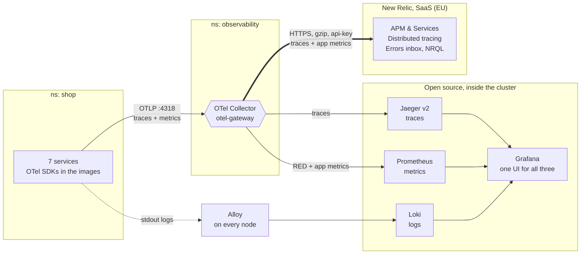
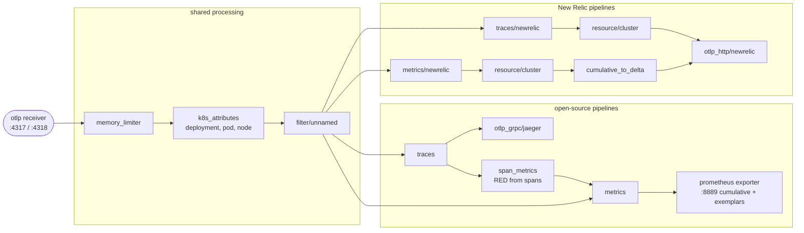

# Observability — open source stack + New Relic

How the e-commerce demo on the local kind cluster is observed: what is installed, how traces, metrics and logs flow, how every piece is configured, how to use it, and how to fix it when it breaks.

All paths are relative to `using-kubernetes/`.

## Contents

1. [Overview](#1-overview)
2. [Architecture](#2-architecture)
3. [Components and versions](#3-components-and-versions)
4. [Installation (from scratch)](#4-installation-from-scratch)
5. [Metrics — Prometheus](#5-metrics--prometheus)
6. [Traces — OpenTelemetry Collector + Jaeger](#6-traces--opentelemetry-collector--jaeger)
7. [Logs — Alloy + Loki](#7-logs--alloy--loki)
8. [Grafana — data sources, links, dashboards](#8-grafana--data-sources-links-dashboards)
9. [Alerts and SLOs (paused)](#9-alerts-and-slos-paused)
10. [New Relic APM (OpenTelemetry export)](#10-new-relic-apm-opentelemetry-export)
11. [Using it: investigating a problem](#11-using-it-investigating-a-problem)
12. [Operations](#12-operations)
13. [Troubleshooting](#13-troubleshooting)
14. [Version pins and why](#14-version-pins-and-why)
15. [Security notes](#15-security-notes)

---

## 1. Overview

| Signal | Produced by | Collected by | Stored in | Viewed in |
|---|---|---|---|---|
| **Traces** | OpenTelemetry SDKs inside each service image | OTel Collector `otel-gateway` | Jaeger v2 · New Relic | Jaeger UI · Grafana · New Relic APM |
| **Metrics** | SDKs, span metrics, RabbitMQ, DB exporters, node-exporter, kube-state-metrics, kubelet | Prometheus (scrape) · collector (push) | Prometheus · New Relic (app metrics) | Grafana · Jaeger Monitor tab · New Relic |
| **Logs** | Every container's stdout | Alloy on each node | Loki | Grafana Explore |

Everything runs in the `observability` namespace and is installed with Helm:

- **Third-party charts** (Prometheus stack, OTel Operator, Jaeger, Loki, Alloy, exporters), configured by the values files in `observability/`.
- **Our own chart** `charts/observability-config` (release `obs-config`): the collector, routes, monitors, dashboards, alert rules and the New Relic switch.

Web UIs (open in Chrome; Safari may not resolve `*.localhost`):

| Tool | URL |
|---|---|
| Grafana | http://grafana.localhost |
| Jaeger | http://jaeger.localhost |
| Prometheus | http://prometheus.localhost |
| Alertmanager | http://alertmanager.localhost |
| RabbitMQ admin | http://rabbitmq.localhost |
| New Relic | https://one.eu.newrelic.com |

---

## 2. Architecture



Solid arrows push data; dotted arrows are Prometheus pulling (scraping) or Jaeger querying Prometheus.

### One source, two destinations



### Inside the collector: four pipelines



| Difference | Open source | New Relic | Why it matters |
|---|---|---|---|
| Metric format | Cumulative totals (Prometheus computes rates) | Deltas per interval | One shared pipeline can't serve both: only New Relic's gets `cumulative_to_delta` |
| RED metrics | Built in the collector by `span_metrics` | Built by New Relic from the spans | Sending span metrics too would double-count, so they stay Prometheus-only |
| Transport | Plain gRPC inside the cluster | HTTPS + gzip to `otlp.eu01.nr-data.net` | Traffic leaves the cluster, so it's compressed and authenticated |
| Authentication | None (cluster-internal) | `api-key` header from Secret `newrelic-license` | The key never appears in chart files or Git |
| Extra context | Pod, node, deployment, namespace | Same, plus `k8s.cluster.name` | New Relic groups and links entities by cluster |

### Why both

| Question | Open source stack | New Relic |
|---|---|---|
| Who runs it | You: upgrades, storage, memory limits, outages | New Relic runs the backend; you only send data |
| Cost | Free software; you pay in compute, disk and time | Free tier 100 GB/month, then per GB and per user |
| Data location | Stays in the cluster | Leaves the cluster (EU region) |
| Retention here | 2 days metrics/logs; traces until restart | Set by the New Relic plan |
| Strengths | Full control, any query (PromQL, LogQL), no lock-in, works offline | Ready-made APM views, errors inbox, alerting with no setup |

**Design choices**

- **Same data, side by side.** The same checkout appears in Jaeger and New Relic, so the tools can be compared on identical traces.
- **One collector for all app telemetry.** Services only know `otel-gateway-collector.observability:4318`. Adding or removing a backend (Jaeger, New Relic, anything else) is a collector change, never an app change.
- **Logs bypass the collector.** Alloy reads log files on each node, so logs work even for pods with no SDK (databases, Traefik, the monitoring tools themselves).
- **Separate pipelines per destination.** Prometheus needs cumulative metrics, New Relic needs deltas; Jaeger and New Relic get the same spans through independent pipelines, so a failure on one side doesn't affect the other.

---

## 3. Components and versions

| Release | Chart (pinned) | App version | Values file | Pods |
|---|---|---|---|---|
| `kps` | prometheus-community/kube-prometheus-stack **91.8.2** | operator v0.94.1, Grafana 13.2.3 | `observability/kube-prometheus-stack-values.yaml` | Prometheus, Grafana, Alertmanager, operator, kube-state-metrics, node-exporter ×3 |
| `otel-operator` | open-telemetry/opentelemetry-operator **0.124.0** | collector 0.160.0 | `observability/otel-operator-values.yaml` | operator |
| `obs-config` | `charts/observability-config` (ours) | — | `charts/observability-config/values.yaml` | otel-gateway-collector |
| `jaeger` | jaegertracing/jaeger **4.13.1** | **Jaeger 2.20.0** | `observability/jaeger-values.yaml` | jaeger |
| `loki` | grafana/loki **7.3.0** | Loki 3.6.12 | `observability/loki-values.yaml` | loki-0 |
| `alloy` | grafana/alloy **1.13.0** | Alloy 1.20.0 | `observability/alloy-values.yaml` | alloy ×3 (one per node) |
| `postgres-exporter` | prometheus-community/prometheus-postgres-exporter **8.2.0** | v0.20.1 | `observability/exporters/postgres-values.yaml` | 1 |
| `redis-exporter` | prometheus-community/prometheus-redis-exporter **6.32.1** | v1.92.1 | `observability/exporters/redis-values.yaml` | 1 |
| `mongodb-exporter` | prometheus-community/prometheus-mongodb-exporter **3.22.0** | 0.53.0 | `observability/exporters/mongodb-values.yaml` | 1 |

Memory used by the whole stack: about 3–3.5 GB. Docker Desktop should have 10–12 GB.

---

## 4. Installation (from scratch)

Prerequisites: the cluster, Traefik, the middleware and the shop are installed (see `README.md`, phases 1–3).

```bash
# Helm repos
helm repo add prometheus-community https://prometheus-community.github.io/helm-charts
helm repo add open-telemetry https://open-telemetry.github.io/opentelemetry-helm-charts
helm repo add jaegertracing https://jaegertracing.github.io/helm-charts
helm repo add grafana https://grafana.github.io/helm-charts
helm repo update

# 1. Prometheus + Grafana + Alertmanager + cluster metrics
helm upgrade --install kps prometheus-community/kube-prometheus-stack --version 91.8.2 \
  -n observability --create-namespace -f observability/kube-prometheus-stack-values.yaml --wait

# 2. Database exporters
helm upgrade --install postgres-exporter prometheus-community/prometheus-postgres-exporter --version 8.2.0 \
  -n observability -f observability/exporters/postgres-values.yaml
helm upgrade --install redis-exporter prometheus-community/prometheus-redis-exporter --version 6.32.1 \
  -n observability -f observability/exporters/redis-values.yaml
helm upgrade --install mongodb-exporter prometheus-community/prometheus-mongodb-exporter --version 3.22.0 \
  -n observability -f observability/exporters/mongodb-values.yaml

# 3. Jaeger v2
helm upgrade --install jaeger jaegertracing/jaeger --version 4.13.1 \
  -n observability -f observability/jaeger-values.yaml --wait

# 4. OpenTelemetry Operator
helm upgrade --install otel-operator open-telemetry/opentelemetry-operator --version 0.124.0 \
  -n observability -f observability/otel-operator-values.yaml --wait

# 5. Logs
helm upgrade --install loki grafana/loki --version 7.3.0 -n observability -f observability/loki-values.yaml --wait
helm upgrade --install alloy grafana/alloy --version 1.13.0 -n observability -f observability/alloy-values.yaml --wait

# 6. New Relic license key (only if newrelic.enabled is true — see section 10)
kubectl -n observability create secret generic newrelic-license \
  --from-literal=NEW_RELIC_LICENSE_KEY=<ingest license key>

# 7. Our objects: collector, routes, monitors, dashboards, rules
helm upgrade --install obs-config charts/observability-config -n observability
```

Order matters in two places: the Operator must exist before `obs-config` (it defines the `OpenTelemetryCollector` type), and kube-prometheus-stack must exist before anything that creates `ServiceMonitor` or `PrometheusRule` objects.

**Check everything is up**

```bash
kubectl -n observability get pods                 # all Running
helm list -n observability                        # all deployed
for h in grafana jaeger prometheus alertmanager; do
  printf "%-14s %s\n" $h "$(curl -s -o /dev/null -w '%{http_code}' -L http://$h.localhost/)"; done
```

---

## 5. Metrics — Prometheus

### What is scraped

| Target (job) | How it is configured | What it provides |
|---|---|---|
| kubelet / cAdvisor | built into kube-prometheus-stack | container CPU, memory, network per pod |
| kube-state-metrics | built in | pod status, restarts, **requests and limits**, deployments |
| node-exporter ×3 | built in | node CPU, memory, disk, network |
| apiserver, CoreDNS | built in | control-plane health |
| RabbitMQ (`rabbitmq`) | `ServiceMonitor` in `obs-config` (`templates/middleware-monitoring.yaml`) | `/metrics` totals + `/metrics/detailed?family=queue_coarse_metrics` per queue |
| Traefik | `PodMonitor` in `obs-config` | requests, latency per route |
| Postgres / Redis / MongoDB exporters | each chart's `serviceMonitor.enabled: true` | `pg_*`, `redis_*`, `mongodb_*` |
| OTel collector app metrics (:8889) | `ServiceMonitor otel-gateway-app-metrics` in `obs-config` | span metrics (RED) + services' own metrics |
| OTel collector self-metrics (:8888) | created by the Operator (`observability.metrics.enableMetrics`) | `otelcol_*` (received / sent / failed) |

kind runs etcd, the scheduler, the controller manager and kube-proxy reachable only from inside their node, so those jobs are disabled to avoid permanent "down" targets.

### Key Prometheus settings (`observability/kube-prometheus-stack-values.yaml`)

| Setting | Value | Why |
|---|---|---|
| `retention` | 2d | small disk; this is a lab |
| `scrapeInterval` | 15s | |
| `enableFeatures` | `exemplar-storage` | metric samples carry a trace ID → click through to the trace |
| `*SelectorNilUsesHelmValues` | false (×4) | Prometheus picks up **every** ServiceMonitor / PodMonitor / PrometheusRule in every namespace, without release labels |
| `storageSpec` | 5 Gi PVC | history survives restarts |
| resources | 400 Mi request / 1200 Mi limit | |

### Useful metric names

```promql
# RED metrics from spans (span_metrics connector)
sum by (service_name) (rate(traces_span_metrics_calls_total{span_kind="SPAN_KIND_SERVER"}[5m]))
histogram_quantile(0.95, sum by (le, service_name) (rate(traces_span_metrics_duration_milliseconds_bucket[5m])))

# requests / limits / usage
kube_pod_container_resource_requests{resource="cpu"}
container_memory_working_set_bytes{namespace="shop", container!=""}

# middleware
rabbitmq_detailed_queue_messages_ready
pg_stat_database_numbackends{datname="shop"}

# collector health (no _total suffix on collector self-metrics)
sum by (exporter) (rate(otelcol_exporter_sent_spans[5m]))
sum by (exporter) (rate(otelcol_exporter_send_failed_spans[5m]))
```

---

## 6. Traces — OpenTelemetry Collector + Jaeger

### How services send telemetry

The shop chart's library template (`charts/ecommerce/charts/ecommerce-common/templates/_app.tpl`) gives every service these environment variables:

| Variable | Value |
|---|---|
| `OTEL_SERVICE_NAME` | the chart name, e.g. `order-service` |
| `OTEL_EXPORTER_OTLP_ENDPOINT` | `http://otel-gateway-collector.observability.svc.cluster.local:4318` (`global.otel.endpoint`) |
| `OTEL_EXPORTER_OTLP_PROTOCOL` | `http/protobuf` |
| `OTEL_RESOURCE_ATTRIBUTES` | `deployment.environment=kind,service.namespace=ecommerce,k8s.pod.name=…,k8s.namespace.name=…,k8s.node.name=…` (pod/node via the downward API) |

The SDKs are already in the images: Java agent (order-service), Python `opentelemetry-instrument` (product-service), Node.js SDK (cart, inventory, notification), .NET SDK (payment-service), Go SDK (api-gateway). RabbitMQ messages carry `traceparent`, so async steps join the same trace.

### The collector (`charts/observability-config/templates/otel-gateway.yaml`)

An `OpenTelemetryCollector` object named `otel-gateway` (mode: deployment). The Operator turns it into Deployment + Service `otel-gateway-collector`. Image: `otel/opentelemetry-collector-contrib:0.160.0` (set in `otel-operator-values.yaml`).

| Component | Type | Purpose |
|---|---|---|
| `otlp` | receiver | gRPC :4317, HTTP :4318 |
| `memory_limiter` | processor | protects the collector (80% of its limit) |
| `k8s_attributes` | processor | looks up the sending pod in the API and adds `k8s.deployment.name`, `k8s.pod.uid`, … (needs the ClusterRole `otel-gateway-k8sattributes`) |
| `filter/unnamed` | processor | drops data from processes with no service name (`unknown_service:*`) |
| `batch` | processor | sends in batches every 5 s |
| `resource/cluster` | processor | adds `k8s.cluster.name=kind-ecommerce` (New Relic pipelines) |
| `cumulative_to_delta` | processor | converts metrics for New Relic |
| `span_metrics` | connector | turns spans into RED metrics with exemplars (dimensions: method, status code, namespace) |
| `otlp_grpc/jaeger` | exporter | → `jaeger.observability:4317` |
| `prometheus` | exporter | :8889, OpenMetrics (exemplars) |
| `otlp_http/newrelic` | exporter | → New Relic EU (section 10) |

| Pipeline | Path |
|---|---|
| `traces` | otlp → memory_limiter → k8s_attributes → filter/unnamed → batch → **Jaeger** + **span_metrics** |
| `metrics` | otlp + span_metrics → memory_limiter → k8s_attributes → filter/unnamed → batch → **Prometheus** |
| `traces/newrelic` | otlp → … → resource/cluster → batch → **New Relic** |
| `metrics/newrelic` | otlp → … → resource/cluster → cumulative_to_delta → batch → **New Relic** |

Collector 0.160 renamed components: `otlp_grpc` / `otlp_http` (exporters), `k8s_attributes`, `span_metrics`, `cumulative_to_delta`. The old names still work but log deprecation warnings.

### Jaeger (`observability/jaeger-values.yaml`)

Jaeger v2 is itself built on the OpenTelemetry Collector; its whole configuration is in `userconfig`:

- receives OTLP on 4317/4318;
- stores traces **in memory** (newest 50,000; lost on restart);
- the **Monitor** tab reads span metrics from `kps-prometheus:9090`;
- UI and API on 16686, route `jaeger.localhost` created by the chart (`jaeger.httproute`).

**Pinned to Jaeger 2.20** (chart 4.13.1): 2.21+ removed the v1 HTTP API (`/api/services`, `/api/traces`) that Grafana 13's Jaeger data source and the shop's architecture page use.

**Expected result:** one checkout = one trace of ~33 spans across 6 services (api-gateway, cart, order, payment, inventory, notification). A declined payment has ~28 (no stock deduction).

---

## 7. Logs — Alloy + Loki

### Loki (`observability/loki-values.yaml`)

Single-binary mode with local disk — the chart's default "simple scalable" mode (separate read/write/backend + S3) is for clusters, not laptops.

| Setting | Value | Why |
|---|---|---|
| `deploymentMode` | SingleBinary | one process does everything |
| `auth_enabled` | false | single tenant, no `X-Scope-OrgID` |
| `storage.type` | filesystem | 5 Gi PVC on `loki-0` |
| `schemaConfig` | TSDB, v13, 24 h index | current recommended schema |
| `retention_period` | 48h (compactor deletes) | matches Prometheus |
| `allow_structured_metadata` | true | `trace_id` stored per line without becoming a label |
| gateway, caches, canary, tests | off | not needed locally |

### Alloy (`observability/alloy-values.yaml`)

A DaemonSet — one pod per node, including the control-plane node (toleration), so Traefik's logs are collected too. Each pod reads only its own node's `/var/log/pods`.

| Step | Block | What it does |
|---|---|---|
| 1 | `discovery.kubernetes` | pods on **this node** (`spec.nodeName=$NODE_NAME`) — no duplicates |
| 2 | `discovery.relabel` | labels `namespace`, `pod`, `container`, `app`, `node`; builds the log path |
| 3 | `local.file_match` + `loki.source.file` | tail the files |
| 4 | `stage.cri` | unwrap containerd's log format |
| 5 | `stage.multiline` (order-service) | **join Java stack traces** into one entry |
| 6 | `stage.replace` ×2 | **mask PII**: emails → `<email-masked>`, 13–16-digit numbers → `<card-masked>` |
| 7 | `stage.regex` + `stage.structured_metadata` | extract `trace_id` from any of our formats |
| 8 | `stage.regex` ×2 + `stage.template` + `stage.labels` | log `level` label, normalised (information → info, warning → warn, missing → unknown) |
| 9 | `loki.write` | push to `loki:3100` |

The chart passes this config through Helm's template engine, so Alloy's own `{{ }}` is escaped as `` {{`…`}} ``.

### Querying logs (Grafana → Explore → Loki)

```logql
{namespace="shop"}
{app="order-service", level="error"}
{namespace="shop"} | trace_id="<32-hex trace id>"
sum by (app) (count_over_time({namespace="shop", level=~"error|warn"}[5m]))
{namespace=~".+"} |~ "(?i)amqp|rabbitmq"
```

Labels: `namespace`, `pod`, `container`, `app`, `node`, `level`. Structured metadata: `trace_id`.

---

## 8. Grafana — data sources, links, dashboards

### Data sources (provisioned from `kube-prometheus-stack-values.yaml`)

| Name | uid | URL | Links configured |
|---|---|---|---|
| Prometheus | `prometheus` | built in | exemplars → Jaeger (`trace_id`) |
| Loki | `loki` | `loki.observability:3100` | `trace_id` → **View trace** in Jaeger |
| Jaeger | `jaeger` | `jaeger.observability:16686` | span → **Logs for this span** (Loki, `app` = service.name, ±2 min, trace filter); span → request/error rate (Prometheus); node graph |

### Dashboards (folder **Shop**, from `charts/observability-config/dashboards/`)

| Dashboard | What it shows |
|---|---|
| **Shop — Services RED** (`/d/shop-red`) | throughput, error rate, p95 per service; slowest operations; payments / checkouts / notifications per minute; recent warnings and errors (Loki) |
| **Shop — Infrastructure (Kubernetes)** (`/d/shop-infra`) | CPU and memory per pod (shop + middleware); RabbitMQ queues, rates, consumers; Postgres, Redis, MongoDB |
| **Pod Infra** (`/d/pod-infra`) | per service: Pods, cpu-req, cpu-limit, Avg/Max CPU %, mem-req, mem-limit, Avg/Max Mem % (usage ÷ request); per pod: requests, limits, avg, max, % of request, memory % of limit |

Dashboards are JSON files turned into ConfigMaps (`templates/dashboards.yaml`, label `grafana_dashboard=1`, annotation `grafana_folder: Shop`); Grafana's sidecar loads them. The ~25 built-in kube-prometheus-stack dashboards are disabled (`grafana.defaultDashboardsEnabled: false`).

**To add a dashboard:** build it in Grafana → Share → Export → save JSON into `charts/observability-config/dashboards/` → `helm upgrade obs-config charts/observability-config -n observability`.

### Grafana settings worth knowing

- Anonymous **Admin**, login form disabled — **local lab only**.
- No persistence: everything is re-provisioned from files on start; UI edits to provisioned dashboards are lost.
- Memory limit 768 Mi (384 Mi was OOMKilled — Grafana 13 builds search indexes at start-up).

---

## 9. Alerts and SLOs (paused)

Rules are written in `charts/observability-config/rules/shop-rules.yaml` but **switched off** (`alerts.enabled: false`). The built-in kube-prometheus-stack rules (KubePodCrashLooping, KubePodNotReady, KubeNodeNotReady, KubePersistentVolumeFillingUp, …) are active.

| Alert | Condition | Severity |
|---|---|---|
| RabbitMQDown | no healthy RabbitMQ target for 1 min | critical |
| DatabaseExporterSeesDown | `pg_up`/`redis_up`/`mongodb_up` = 0 for 1 min | critical |
| ServiceHighErrorRate | > 5% of server spans failing for 3 min | warning |
| CheckoutSlow | checkout p95 > 1000 ms for 5 min | warning |
| ContainerOOMKilled | a shop/middleware container OOMKilled in the last 10 min | warning |
| TelemetryExportFailing | collector failing to export spans for 5 min | warning |
| CheckoutSLOFastBurn / SlowBurn | checkout SLO 99%: 14.4× burn (1 h & 5 m) / 6× burn (6 h & 30 m) | critical / warning |

Recording rules `slo:checkout_errors:ratio_rate{5m,30m,1h,6h}` feed the burn-rate alerts.

**Enable:** set `alerts.enabled: true` in `charts/observability-config/values.yaml` → `helm upgrade obs-config …`. Alerts then appear at http://prometheus.localhost/alerts and http://alertmanager.localhost (no notification channel is configured yet).

**Test:** `kubectl -n middleware scale statefulset rabbitmq --replicas=0` → RabbitMQDown fires within ~2 min → scale back to 1.

---

## 10. New Relic APM (OpenTelemetry export)

The collector sends the same traces, plus the services' own metrics, to New Relic EU. No app or image changes ("option A").

### Configuration (`charts/observability-config/values.yaml`)

```yaml
newrelic:
  enabled: true
  endpoint: https://otlp.eu01.nr-data.net   # US accounts: https://otlp.nr-data.net
  licenseSecret: newrelic-license
  clusterName: kind-ecommerce
```

### License key

Stored only in a Secret — never in values files or Git:

```bash
kubectl -n observability create secret generic newrelic-license \
  --from-literal=NEW_RELIC_LICENSE_KEY=<ingest license key>
```

Use an **Ingest – License** key (40 characters, ends in `NRAL`). A User key (`NRAK-…`) is rejected with 403. The collector reads it through an environment variable and sends it as the `api-key` header (`${env:NEW_RELIC_LICENSE_KEY}`).

### What is sent

| Sent | Not sent (and why) |
|---|---|
| All spans, with `service.name`, `deployment.environment`, `k8s.pod.name`, `k8s.node.name`, `k8s.deployment.name`, `k8s.namespace.name`, `k8s.cluster.name` | span_metrics — New Relic derives RED metrics from spans itself |
| The services' own metrics (runtime + `payments_processed`, `cart_checkouts`, `notifications_sent`) as **deltas** | logs — Loki only for now |
| | Kubernetes infrastructure — needs New Relic's `nri-bundle` (not installed) |
| | RabbitMQ / database metrics — Prometheus only |

### Verify

```bash
P=$(kubectl -n observability get pods -l app.kubernetes.io/name=otel-gateway-collector -o name | head -1)
kubectl -n observability port-forward $P 18888:8888 &
curl -s localhost:18888/metrics | grep -E '^otelcol_exporter_(sent|send_failed)_(spans|metric_points)'
# otlp_http/newrelic sent_spans should equal otlp_grpc/jaeger sent_spans; no send_failed
```

In New Relic: **APM & Services → OpenTelemetry** (services appear after they receive requests; payment, inventory and notification act only during a checkout) → **Distributed tracing** → a checkout spans 6 services.

```sql
FROM Span SELECT count(*) FACET service.name, k8s.pod.name SINCE 30 minutes ago
FROM Span SELECT percentile(duration.ms, 95) FACET service.name, name SINCE 1 hour ago LIMIT 20
FROM Span SELECT count(*) WHERE otel.status_code = 'ERROR' FACET service.name SINCE 1 hour ago
FROM Span SELECT count(*) WHERE name NOT LIKE '%health%' FACET service.name SINCE 1 hour ago
FROM Metric SELECT uniques(metricName) WHERE k8s.cluster.name = 'kind-ecommerce' SINCE 1 hour ago
```

### Operate

| Task | How |
|---|---|
| Turn off | `newrelic.enabled: false` → `helm upgrade obs-config …` (Jaeger/Prometheus unaffected) |
| Rotate key | new Ingest key → recreate the Secret (`--dry-run=client -o yaml \| kubectl apply -f -`) → `kubectl -n observability rollout restart deploy/otel-gateway-collector` → delete the old key |
| US account | change `newrelic.endpoint` and use a US key |

Detailed guide: `docs/NewRelic_APM_Kubernetes_Setup.docx`.

---

## 11. Using it: investigating a problem

Example: RabbitMQ stops and checkouts fail.

1. **Grafana → Shop — Services RED:** error rate rises on api-gateway, cart-service and order-service. Order-service is the deepest.
2. **Click an exemplar** on the error or latency graph (or Jaeger → service `order-service`, tag `error=true`): the lowest red span is `order-service POST /orders` **500**, event `org.springframework.amqp.AmqpConnectException: Connection refused`.
3. **"Logs for this span"** → Loki shows the order-service error with the full stack trace as one entry (multiline join).
4. **Confirm the cause:** `up{job="rabbitmq"}` drops to 0, or Shop — Infrastructure shows RabbitMQ connections at 0. Inventory and notification log `rabbitmq not ready, retrying`.
5. **New Relic:** order-service → Errors inbox shows the same exception class and stack trace.

The same pattern works for any failure: **lowest failing span → its exception → its logs → the dependency's metrics.**

---

## 12. Operations

| Task | Command |
|---|---|
| Pause / resume the whole cluster | `docker stop ecommerce-control-plane ecommerce-worker ecommerce-worker2` / `docker start …` (data kept; Jaeger's in-memory traces lost) |
| Fake traffic on / off | `kubectl -n shop scale deploy/loadgen --replicas=1` / `0` (default 0 in `values-kind.yaml`) |
| Change a tool's settings | edit its file in `observability/` → run the `helm upgrade --install` line from that file's header |
| Change our objects (collector, dashboards, rules, New Relic) | edit `charts/observability-config` → `helm upgrade obs-config charts/observability-config -n observability` |
| Restart the collector | `kubectl -n observability rollout restart deploy/otel-gateway-collector` |
| Keep data longer | Prometheus `retention` + `storageSpec`; Loki `retention_period` + `persistence.size`; Jaeger `max_traces` or a real backend |
| Check resource use | Grafana → Pod Infra |
| Remove everything | `helm uninstall <release> -n observability` for each release; `kubectl -n observability delete pvc --all` |

---

## 13. Troubleshooting

Problems met while building this setup, and their fixes.

| Symptom | Cause | Fix |
|---|---|---|
| Grafana 503 / restarting | OOMKilled at 384 Mi | limit 768 Mi (done); consider 1 Gi + `GOMEMLIMIT` |
| Grafana "Jaeger: 404 Not Found" | Jaeger 2.21+ has no v1 API | keep Jaeger 2.20 (chart 4.13.1) |
| `helm --wait` hangs on Traefik | chart sets Service type under `service.spec.type`; LoadBalancer never gets an IP on kind | `service.spec.type: ClusterIP` (done) |
| Alloy chart fails: `function "ToLower" not defined` | chart runs the config through Helm `tpl` | wrap Alloy templates in `` {{`…`}} `` |
| Alloy missing on the control-plane node | control-plane taint | toleration in `controller.tolerations` (done) |
| `obs-config` won't render: `undefined variable "$labels"` | Prometheus `{{ $labels }}` in a Helm template (even in a comment) | rules live in `rules/shop-rules.yaml`, included with `.Files.Get` |
| Services log "export failed" | collector not running yet | expected until phase 4; check `otel-gateway-collector` pod |
| Collector warns "alias is deprecated" | 0.160 renamed components | use `otlp_grpc`, `otlp_http`, `k8s_attributes`, `span_metrics`, `cumulative_to_delta` |
| Collector `otelcol_*_total` queries return nothing | collector self-metrics have no `_total` suffix | query `otelcol_exporter_sent_spans` |
| `replicas: 0` deploys 1 pod | `default 1` treats 0 as empty | library uses `kindIs "invalid"` (fixed) |
| Pod Infra shows CPU > 1000% | broken counters from a crash-looping pod's restarts | ages out of the time range; use a shorter range |
| Pod % columns inflated | sidecars without requests counted in usage | only containers with a request are counted (fixed) |
| `*.localhost` works in Chrome, not Safari / Python | macOS resolver doesn't map subdomains of localhost | use Chrome or curl, or add `/etc/hosts` entries |
| New Relic 403 | User key instead of Ingest key, or wrong region | Ingest – License key; EU endpoint for EU accounts |
| New Relic collector pod `CreateContainerConfigError` | Secret `newrelic-license` missing | create it |

Handy commands:

```bash
kubectl -n observability get pods
kubectl -n observability logs deploy/otel-gateway-collector --tail=100 | grep -iE "error|warn"
kubectl -n observability logs ds/alloy -c alloy --tail=50
curl -s http://prometheus.localhost/api/v1/targets | python3 -c "import json,sys;[print(t['labels']['job'],t['health']) for t in json.load(sys.stdin)['data']['activeTargets']]"
curl -s http://grafana.localhost/api/datasources/uid/jaeger/health
```

---

## 14. Version pins and why

| Pin | Reason |
|---|---|
| Jaeger chart 4.13.1 (Jaeger 2.20.0) | 2.21+ removed the v1 HTTP API used by Grafana 13 and the architecture page |
| Collector contrib 0.160.0 | default "k8s" collector build lacks span_metrics and k8s_attributes |
| Gateway API v1.6.1 CRDs | Traefik 3.7 is built against it (watches TLSRoute) |
| All other charts | newest release at least two weeks old at install time (October 2026) |

---

## 15. Security notes

- **Local lab settings:** Grafana anonymous admin, Prometheus/Alertmanager/Jaeger UIs open on `*.localhost`, demo database passwords in values files. Never reuse these settings outside a laptop.
- **Secrets:** the New Relic key exists only in a Kubernetes Secret (base64, not encrypted in kind). Real clusters: External Secrets, Sealed Secrets or a cloud secret manager.
- **PII:** Alloy masks emails and card-like numbers before logs are stored. Logs are not sent to New Relic.
- **Rotate** any key or token that has been pasted into chats or tickets.
